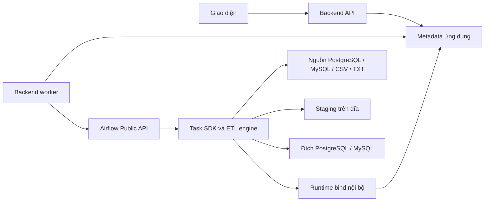

# Kiến trúc Airflow Automation Tool

## Thành phần và luồng dữ liệu

Frontend React/TypeScript gọi API FastAPI qua Nginx. Backend lưu metadata trong
PostgreSQL, mã hóa credentials bằng keyring riêng và ghi operations bền để
backend-worker xử lý. Airflow 3.3.2 là bộ điều phối và thực thi ETL duy nhất;
backend không tự lập lịch thay Airflow và không đọc trực tiếp metadata DB Airflow.

Excel được validate thành metadata có version; DAG sinh từ fixed template, không
thực thi Python hoặc SQL tùy ý từ workbook. Deploy chỉ thành công sau khi xác
minh đăng ký, ownership và revision qua public API Airflow.

## Tính toàn vẹn và phục hồi

RunIntent giữ identity lệnh trigger. ExecutionBinding cố định revision, nguồn,
đích và quyền cho một run. Retry giữ binding; redeploy đóng admission và đợi run
cũ kết thúc. Cách này tránh đổi cấu hình giữa run nhưng có thể làm deploy chờ
hoặc bị từ chối khi target/run còn bận.

ETL streaming qua staging JSONL có checksum/manifest COMPLETE trên disk;
không chuyển dataset qua XCom. APPEND có thể tạo duplicate khi chạy run mới;
UPSERT cần khóa thật. FULL_REFRESH chuẩn bị toàn bộ mapped dataset rồi thay
thế trong một transaction đã được cấp quyền. Ledger đích là bằng chứng commit;
mất phản hồi commit phải đối soát, không tự replay hoặc xóa staging được bảo vệ.

ONCE gắn độc quyền với Run ID. SCHEDULED chỉ áp dụng đúng lịch và scope đã duyệt.
Thu hồi chặn admission mới, không hứa hủy transaction đã bắt đầu. Xem
[hợp đồng runtime](../specs/001-airflow-automation-tool/contracts/runtime.md).

## Triển khai và giới hạn

Compose tách database ứng dụng, Airflow, backend/worker và frontend; secrets,
keyring, uploads, DAGs, logs và staging có volumes riêng. Test dùng project,
network, credentials và databases riêng, không dùng demo làm fixture.

MVP dành cho một operator local/loopback. Quyền local có điều kiện không đồng
nghĩa nghiệm thu security hoặc sản phẩm đầy đủ. Trạng thái kiểm chứng ở
[checkpoint](testing/product-resume-20261112.md); phiên bản, resource limits và
dependency locks được định nghĩa tại [plan](../specs/001-airflow-automation-tool/plan.md).

