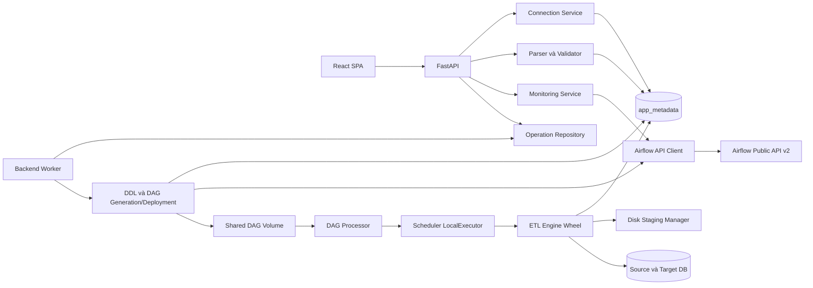

# Kế hoạch triển khai: Airflow Automation Tool

**Nhánh/ngữ cảnh Spec Kit**: `001-airflow-automation-tool` | **Ngày**: 2026-11-06

**Đặc tả**: [spec.md](spec.md), đã Clarify, gồm 5 quyết định vòng đời FULL_REFRESH tại BR-08.
**Đầu vào bổ sung**: yêu cầu Plan17nhóm, Constitution1.0.0 và các finding Analyze cần đồng bộ
thiết kế. Không tạo application source code, Dockerfile/Compose hoặc migrations; giữ nguyên
[tasks.md](tasks.md) cho bước Tasks tiếp theo. Workbook .xlsx hiện có được tái sử dụng.

## Tóm tắt

Modular monolith với React/TypeScript SPA, FastAPI API và một backend-worker cùng codebase,
PostgreSQL application metadata và Airflow3.3.2 LocalExecutor. Airflow chạy ETL package wheel,
không dùng FastAPI request để chạy ETL. Excel1.0 điều khiển table/DAG/config/mapping, không
thực thi code. DB-to-DB snapshot một table → JSONL typed disk staging → validate → load batch.
Credentials mã hóa trong application DB, giải mã tại runtime qua keyfile riêng, không API response.

APPEND/UPSERT có target-native session lock và target transaction commit ledger; FULL_REFRESH
chuẩn bị dữ liệu trước rồi một transaction replacement, không TRUNCATE/DROP/ALTER table cũ.
Dashboard/history lấy Public API Airflow, không sao chép lịch sử vào app DB. Tất cả design
artifacts tiếng Việt; UI và workbook instructions tiếng Anh.

## Bối cảnh kỹ thuật

| Mục | Quyết định |
| --- | --- |
| Ngôn ngữ/runtime | TypeScript5.9.3, Python3.12; backend image3.12.12; Node22.21.1 build |
| Frontend | React/DOM19.2.0, Vite7.3.7, plugin-react5.1.1, Tailwind/@tailwindcss/vite4.1.18 |
| UI/data/form | shadcn CLI3.5.0, React Router7.9.6, TanStack Query5.90.10, RHF7.66.0, resolvers5.2.2, Zod4.1.12 |
| Backend | FastAPI0.136.3, Uvicorn0.38.0, Pydantic2.13.5, SQLAlchemy2.0.52, Alembic1.20.0 |
| IO/security | openpyxl3.1.5, defusedxml0.7.1, psycopg[binary]3.3.5, PyMySQL1.1.3, cryptography50.0.1, httpx0.28.1 |
| Orchestration | apache/airflow:3.3.2-python3.12, LocalExecutor, Task SDK, Public APIv2 |
| Databases | postgres:17.6-bookworm, mysql:8.4.7 InnoDB/utf8mb4/strict mode |
| Web image | nginx:1.28.0-alpine, SPA static và same-origin API reverse proxy |
| Kiểm thử | pytest8.4.2, Playwright1.56.1, DB/Airflow integration thật, schema/contract checks |
| Nền tảng | Linux containers trên Docker Engine/Desktop; Composev2>=2.24; Windows source dùng Docker volumes cho IO |
| Phạm vi | Một operator local, không login;6màn hình,8hướng ETL; một source/target mỗi DAG |
| Hiệu năng | p95 list/detail/preview100dòng<=3giây trên fixture; connection<=30giây; registration<=120giây |
| Tài nguyên | ETL512MiB/process, parallelism2; staging10GiB/run/20GiBglobal; chi tiết runtime.md |

Pin baseline, nguồn và tradeoffs ở [research.md](research.md), bằng chứng registry ở
[dependency-verification.json](contracts/dependency-verification.json). Không dùng image latest.
Implementation phải tạo lockfiles/hashes, pin image digest thật sau resolve, chạy npm ci/build,
pip check/backend và custom Airflow. Metadata existence không thay test tương thích hoặc security scan.

## Kiểm tra Constitution

Gate trước nghiên cứu: mọi yêu cầu đầu vào nằm trong Constitution, không có vi phạm cần ngoại lệ.
Gate sau thiết kế dưới đây là đánh giá tính tuân thủ thiết kế, không phải test runtime đã PASS.

| Nguyên tắc | Bằng chứng thiết kế | Trước/sau thiết kế |
| --- | --- | --- |
| I Ngôn ngữ | Markdown tiếng Việt, UI/Excel tiếng Anh, API keys giữ chuẩn kỹ thuật | Đạt/Đạt |
| II Nhận diện/UI | Bố cục mới từ workflow, neutral icon/text, không screenshot/branding ngoài | Đạt/Đạt |
| III Spec Kit | Spec/Clarify→research→plan/data/contracts/quickstart, tasks để lệnh sau | Đạt/Đạt |
| IV Sản phẩm thật/đơn giản | Modular monolith, API/DB/Airflow thật, worker cùng image, không broker | Đạt/Đạt |
| V Metadata | Excel schema1.0, reusable factory/engine, validate/confirm trước side effect | Đạt/Đạt |
| VI Toàn vẹn/secrets | Native locks+ledger, policy riêng, encrypted revisions, không API password | Đạt/Đạt |
| VII Dữ liệu lớn | Snapshot streaming, typed disk staging/quota/recovery, không XCom dataset | Đạt/Đạt |
| VIII Airflow | LocalExecutor/TaskSDK/PublicAPIv2; revision registration; không internal DB nghiệp vụ | Đạt/Đạt |
| IX Docker | One-command init/migrations/seed/readiness/persistent volumes, không setup thủ công | Đạt/Đạt |
| X Kiểm thử | A–AM, failure injection, unit/integration/E2E/stress, chưa chạy không báo PASS | Đạt/Đạt |
| XI Tài liệu | Research/model/contracts/quickstart; README/architecture/troubleshooting implementation phải đồng bộ | Đạt/Đạt |
| XII Phân kỳ |8phase theo phụ thuộc, core trước polish; mỗi phase có gate kiểm chứng | Đạt/Đạt |

Rà soát sau Clarify: nguyên tắc VI còn được bảo vệ bằng ONCE reservation trước trigger,
admission/revoke serialize, ledger commit proof và allow_empty riêng; nguyên tắc III yêu cầu
đồng bộ task trước implementation. Các kết luận Đạt ở bảng là chất lượng thiết kế, không
phải reviewer checklist hoặc test runtime PASS. Tasks còn lệch với contract mới là cổng
chưa hoàn tất của workflow, không được bỏ qua bằng việc kết thúc Plan.

## Cấu trúc dự án

### Tài liệu cho tính năng

```text
specs/001-airflow-automation-tool/
  spec.md
  plan.md
  research.md
  data-model.md
  quickstart.md
  contracts/
    openapi.yaml
    rest-api.md
    airflow.md
    runtime.md
    excel-definitions.md
    dependency-verification.json
    template-artifacts.json
  checklists/requirements.md
```

`tasks.md` chỉ sinh ở `/speckit-tasks`, không giả danh công việc đã thực hiện.

### Cấu trúc source dự kiến ở root

```text
frontend/src/{app,pages,features,components,lib}
backend/src/aat_api/{routes,services,workers,airflow_client,validation,ddl,deployments}
backend/alembic/
packages/aat_metadata/{models,repositories,secrets,runtime_views}
etl_engine/src/aat_etl/{contracts,readers,mapping,staging,loaders,recovery,metrics}
airflow/{dags,plugins,docker}
docker/{postgres,mysql,nginx,bootstrap}
templates/{Table Definition.xlsx,ETL Definition.xlsx}
samples/{definitions,data}
tests/{unit,api,integration,etl,airflow,e2e,stress}
docs/{architecture,operations,testing}
specs/
docker-compose.yml
.env.example
README.md
```

Thêm packages/aat_metadata để backend và ETL dùng repository/types/secret codecs mà không
import FastAPI vào engine. Đây là shared library trong monorepo, không service mới.
Backend imports metadata+engine contracts/adapters; engine imports metadata và SQL drivers;
Airflow wrapper imports SDK+engine. Engine/metadata không imports backend hoặc Airflow ORM.
Frontend chỉ qua OpenAPI-generated types/client và TanStack Query, không truy cập DB/Airflow trực tiếp.

## Kiến trúc module và hướng dependency



- Frontend Application: navigation/wizard, typed forms, previews và progress, không validation authority.
- Metadata Repository: transactions cấu hình, immutable revision/dependency, operations/audit/binding.
- Connection Service: CRUD/test/encrypt/sanitize/pooling/dependency/network allowlist.
- Excel Parser: openpyxl read-only, ZIP safety và cell provenance; Validator: version/schema/reference/type/key.
- SQL DDL Generator: PostgreSQL/MySQL adapter, logical types → SQLAlchemy Core constructs,
  dialect quote/literal defaults kiểm soát; no raw workbook expression.
- DAG Generator/Deployment: fixed wrapper, canonical config, atomic file, owner/revision/admission.
- Airflow API Client: JWT, timeout/pagination/backoff, registration/tasks/log, không internal DB.
- ETL Execution Package/Staging Manager: snapshot/stream/map/validate/load/commit recovery/quota.
- Monitoring Service: normalize Airflow read models, memory TTL30giây/completeness, không copy history.

Connection pool API metadata pool_size5/max_overflow5; external connection test NullPool,
connect10giây, tổng30giây. Runtime source/target connection riêng từng run, không kế thừa
SQLAlchemy pool qua scheduler fork; create sau task start, close tại end. Không log DSN/password.

## Thiết kế Docker Compose

| Service | Image/code | Phụ thuộc/readiness | Volume/trách nhiệm |
| --- | --- | --- | --- |
| secrets-init | backend image bootstrap | one-shot, restart no | Tạo một lần key/DB passwords/JWT/runtime token trên private volumes, không in secret |
| postgres | postgres:17.6-bookworm | secrets-init completed; SELECT1 thật | pg_data; app_metadata/airflow_metadata/etl_test |
| mysql | mysql:8.4.7 | secrets-init completed; SELECT1 thật | mysql_data; etl_test, InnoDB/utf8mb4 |
| db-init | backend image | DBs healthy, one-shot | Tạo DB/users/grants idempotent, sample support objects; bootstrap secrets |
| app-init | backend image | db-init completed | Alembic+seed connections/data/files/templates metadata, owner migration lock |
| airflow-init | custom Airflow image | db-init completed | airflow db migrate, SimpleAuth users, config keys; không app tables |
| airflow-apiserver | custom Airflow image | airflow-init completed | api-server port8080, JWT/auth files, logs read |
| airflow-scheduler | custom Airflow image | airflow-init completed | LocalExecutor process tasks, DAG read/uploads read/staging write/logs/key/runtime DSN |
| airflow-dag-processor | custom Airflow image | airflow-init completed | DAG read, parse; no app database password access nếu không cần |
| backend-worker | backend image | app-init completed | Durable validation/DDL/deploy/reconcile/cleanup, DAG write/uploads/staging, heartbeat |
| backend | backend image | app-init completed, worker ready, Airflow ready | port8000, metadata/API/config, không ETL background process |
| frontend | nginx static build | backend healthy | port80→host3000, /api/v1→backend:8000 |

Không Celery/Redis/worker container ETL riêng vì LocalExecutor dùng scheduler. Không triggerer
vì không dùng deferrable operator. Các service dài hạn restart unless-stopped; init restart no,
thất bại phải báo rõ thay vòng lặp reset dữ liệu. depends_on service_healthy hoặc
service_completed_successfully theo loại; startup không phụ thuộc sleep cố định.

Network `aat_internal` bridge; DB không publish host port theo mặc định. Chỉ expose
127.0.0.1:3000/8000/8080. Browser dùng localhost; backend dùng postgres:5432/mysql:3306,
Airflow API airflow-apiserver:8080; Airflow Execution API cấu hình URL nội bộ api-server.
Generated DAG/deep link không dùng hostname Docker làm browser URL.

Named volumes: pg_data, mysql_data, generated_dags, airflow_logs, uploads, staging,
app_keyring/runtime_secrets, backend_secrets, airflow_secrets, bootstrap_secrets.
Secrets chia domain và mount chỉ đọc vào service cần; bootstrap DB admin key không mount
vào task runtime. UID/GID permissions tự thiết lập trong init, không chmod toàn bộ777.
DAG writer chỉ backend-worker; dag-processor/scheduler read-only. Local files dùng Linux
named volumes tránh disk IO/permission Windows bind mount; templates immutable trong image.

ENV có default local để một lệnh chạy mà không cần copy .env: app URLs, DB names/service
hosts, Airflow version/executor/parallelism, resource limits/retention. Secrets tạo an toàn
trên volume, optional *_FILE overrides; .env.example chỉ hướng dẫn, không commit key thực.
Airflow SQL connection/signing/auth config được nạp từ secret file trong bootstrap/entrypoint,
không nhúng vào DAG hoặc API response. Thiếu key ở DB đã mã hóa làm readiness fail, không regenerate.

Health: frontend static/proxy; backend /api/v1/health/ready kiểm migration/head+app DB+
worker heartbeat+Airflow functional ready; external ETL connections trạng thái riêng.
Airflow API /api/v2/monitor/health phải kiểm JSON metadatabase/scheduler/dag_processor;
scheduler/dag-processor có heartbeat CLI check tương ứng. Cần tách liveness khỏi aggregate
readiness để tránh restart cascade chỉ vì dependency tạm down.

db-init không chỉ initdb.d: mỗi startup kiểm DB/role tồn tại bằng query và CREATE thiếu ngoài
transaction phù hợp; app/Airflow migrations chạy đúng owner và locks. Seed chỉ insert natural
key thiếu, không overwrite dữ liệu người dùng. Dữ liệu mẫu thuộc namespace riêng; restart
volume có dữ liệu phải giữ app revisions/files/DAG/log và cleanup chỉ theo retention đã đối soát.

## Thiết kế workflow và các hợp đồng

### Connections, Excel và DDL

Connection Service dùng metadata revision/secret records, DB error classification theo SQLSTATE/
PyMySQL exception; không trả raw exception chứa DSN. Validate host allowlist trước DNS/connect,
resolve địa chỉ không cho chuyển sang endpoint ngoài allowlist sau rebind. Local allowlist mặc
định postgres/mysql; operator cấu hình DB bên ngoài rõ ràng, không tuyên bố là SSRF-safe public app.

Table workbook chọn target connection, parser trả cell provenance và structured issues. Validation
hoàn chỉnh workbook trước confirmation; SQLAlchemy Core constructs/dialect adapters compile
CREATE TABLE và quote identifiers, default chỉ typed literal. Composite PK theo ordinal, no ALTER/
DROP. Worker execute từng table, kiểm lại quyền/existence ngay trước DDL; MySQL implicit commit
nên không transaction toàn workbook. Kết quả/table ledger xử lý runtime partial, không rollback
ngầm table đã tạo. Sample namespace tách dữ liệu người dùng.

Template1.0 đã có file thực ở templates và samples/definitions,4workbooks được openpyxl mở lại
kiểm tra. Header/required/conditional/default/cross-sheet/version/error quy định ở
[excel-definitions.md](contracts/excel-definitions.md). Download endpoint chỉ serve artifact đã
version/hash; không cho template download phát sinh execution. Endpoint chưa triển khai ở Plan.

### DAG và Airflow

Fixed factory tạo một file wrapper/DAG từ canonical JSON; file chỉ import SDK/controlled
ETL function, DAG metadata và IDs/hash, không secret/Python expression từ cell.
Mỗi DAG execute_etl có max_active_runs1, catchup false, cron/manual và timezone IANA đúngSpec.
Metadata package revision immutable, Airflow task bind qua backend xác minh TI.dag_version,
không request lưu password rồi trả cho task. Secrets runtime lookup không cần restart Airflow.

Local bundle update phải pause+admission gate+drain cả queued/running; runtime kiểm lại gate/
revision để chặn race scheduled run. Worker atomic deploy, poll registration/errors/versions,
120giây kết quả hoặc chưa xác minh, không fixed sleep/success giả. DAG mới paused; full refresh
activation cần authorization đúng target/revision. Old clear sau redeploy bị reject revision mismatch.
Hợp đồng chính xác API/log/token ở [airflow.md](contracts/airflow.md).

### Engine, type và load

[Runtime contract](contracts/runtime.md) chốt format `aat-jsonl/1`, snapshot PG/MySQL,
chunk/batch/byte limits, lossless NULL/Unicode/Decimal/temporal, path/run/attempt và failure recovery.
DB-to-DB extraction hoàn tất trước target ghi; File-to-DB streaming format validation gắn checksum,
full-refresh toàn mapped dataset phải hoàn tất trước replacement. No fetchall/whole dataset RAM/XCom.

Target support DDL chỉ create technical objects sau consent/preview, sample init chuẩn bị;
không tự ALTER user schema. Ledger batch/final cùng transaction target là bằng chứng commit,
app DB metrics chỉ projection. Cùng session native lock và writer ngăn alias/concurrency.
APPEND retry skip commit marker có checksum khớp; UPSERT chosen-key đúng dialect; FULL_REFRESH
DELETE được ủy quyền+insert chunks+verify+marker trong một transaction, giữ old khi fail.
Không autocommit TRUNCATE, rename swap hoặc tắt constraint để đơn giản hóa.

Mọi resource retry có deadline/count và loại lỗi: transient+chứng minh safe mới retry;
validation/type/key/authorization/storage corruption không infinite retry. Kill/commit lost
đối soát server session/ledger/binding trước acquire/replay/cleanup; heartbeat alone không đủ.
Metrics dòng đếm source accepted không dialect affected_rows, đối soát theo strategy, không live count sai snapshot.

### Vòng đời FULL_REFRESH và ranh giới thu hồi

[Data Model](data-model.md) tách Authorization, RunIntent, ExecutionBinding và
ReplacementAdmission. ONCE reservation gắn run_uuid/Run ID ổn định trong transaction cùng
Operation ngay khi tiếp nhận trigger, trước POST Airflow; không dùng TI binding giả khi run
chưa tồn tại. Idempotency replay cùng request trả intent cũ, không cấp quyền cho Run ID mới.
ONCE terminal success → consumed; failure hết retry/canceled đã xác minh → closed; commit
chưa rõ giữ recovery. Không release reservation vì timeout/heartbeat stale.

SCHEDULED chỉ Airflow `run_type=scheduled` trong scope DAG/revision/physical target/strategy/
schedule/timezone/start date/catchup đã xác nhận. Manual trigger/rerun mới dùng ONCE riêng;
activation lịch FULL_REFRESH cần SCHEDULED. allow_empty=false mặc định, true cần acknowledgment
riêng theo cùng scope; đổi scope/revocation invalidates quyền cũ, lỗi nguồn không là empty.

Runtime đã bind giữ native target lock, đối soát final ledger và validate toàn mapped dataset.
Repository app DB khóa authorization row, rồi intent/binding/admission theo lock order chung;
commit admission ngắn là điểm chấp thuận replacement, sau đó mới bắt đầu target transaction.
Revoke khóa cùng row: revoke commit trước admission thì chặn, sau admission thì transaction đã
chấp thuận có thể hoàn tất/rollback. Không giữ app transaction trong ETL, không tuyên bố atomic
app DB/target. Mất phản hồi admission phải đọc lại identity trước ghi; mất target COMMIT dùng
ledger đối soát. Retry sau rollback cần admission epoch mới/quyền còn hiệu lực; commit VERIFIED
chỉ trả kết quả đã có, không replacement lần hai. Runtime role không được cấp/sửa scope quyền.

UI có list/detail/revoke quyền, hiện reservation/state/acknowledgments/replacement_in_progress,
nhãn unknown khi chưa xác minh; thông báo rõ revoke không cancel giao dịch đã admission.
Các public fields không credentials; authority commit vẫn ở target ledger, không ở response.
Quy trình/ca kiểm chứng chi tiết nằm ở [runtime.md](contracts/runtime.md) và [quickstart.md](quickstart.md).

### Dữ liệu UI và API lịch sử sau Analyze

Contract bổ sung dependency refs cho Connections, typed table columns/default/PK/config,
last_successful_run có availability, run/task errors và recovery metrics. History GET đọc
upload/jobs/table detail phân trang từ metadata bền, không dựa ID browser. Parser PATCH tạo
revision immutable trên cùng content, If-Match, block active/recovery và invalidate dependency;
preview có thể đọc cấu hình dự kiến không lưu. Workbook1.0 không đổi schema hoặc sample bytes.
Tên ledger vật lý thống nhất `_aat_control.*` ở PG và `_aat_batch_commits`,
`_aat_run_commits`, `_aat_support_schema_version` ở MySQL; init/runtime dùng chung signature.

### Frontend UI/UX

Ứng dụng mới có sidebar nền trung tính đậm, vùng nội dung sáng, accent xanh lam; tên Airflow
Automation Tool dạng chữ và icon trung tính dự án, không logo bên thứ ba. Desktop-first,
sidebar thu gọn ở390px, bảng scroll trong vùng chứa, focus/keyboard và form labels đầy đủ.
Dùng shadcn components đã commit source và Tailwind tokens thống nhất; không phụ thuộc ảnh mẫu.

| Trang | Bố cục và hành động |
| --- | --- |
| Dashboard |8KPI cards, date/timezone/refresh toolbar, schedule groups, SVG charts từ số liệu thật, recent runs |
| Connections | Search/filter table, detail drawer, form Add/Edit, Test result/time, dependency warning |
| Table Management | Wizard upload→issues→table/SQL preview→confirmation→per-table progress/history |
| DAG Builder | File Sources panel + wizard Definition→dependencies/mapping→schedule/load→confirm→deployment progress |
| DAG Monitoring | Ownership badge, DAG list/details, run/task history, logs drawer, trigger/pause/open Airflow |
| Settings | Default values với unit/range, connectivity read-only, application info |

React Router declarative routes /, /connections, /tables, /dag-builder, /monitoring, /settings.
TanStack Query quản lý server state, invalidation và polling, không optimistic success cho DB/
Airflow side effects. RHF+Zod field rules; Backend authoritative validation trả cell issue table.
Confirmation hiển thị exact target/revision/load consequences; FULL_REFRESH allow_empty riêng.
Empty/loading/error/stale/partial/unknown là trạng thái riêng; external DAG metrics missing là
Not available. UI copy tiếng Anh; tài liệu kiến trúc và hướng dẫn Markdown tiếng Việt.
Không dùng mock dashboard thay kết nối thật; fixture chỉ unit/UI isolation và được gắn rõ.
Charts SVG code-native đơn giản, không thêm thư viện chart chưa pin hoặc tạo bitmap mockup.

### Backend API và công việc nền

[REST API](contracts/rest-api.md), [OpenAPI3.1](contracts/openapi.yaml) định nghĩa contracts hiện tại,
requests/responses/errors/async contracts. API uploads streaming rồi worker parse/validate,
DDL/deploy/trigger202với Operation/idempotency. Public errors tiếng Anh với request_id/code/
location, không stacktrace/credentials/path. ETag/If-Match chống lost update; confirmation signed
10phút gắn hashes và dependency fingerprints, stale thì validation lại.

Same backend image chạy worker riêng process, Operation lease/reconcile bền qua restart.
Worker không chạy ETL hoặc cron thay Airflow; housekeeping chỉ dọn artifact/durable job.
Public API unauthenticated local nhưng origin/CORS/mutation protection; /internal/runtime/bind
service token chỉ nội bộ và không proxy qua frontend. Connection/password input write-only,
không endpoint secret export. OpenAPI runtime phải kiểm drift so với contract đã thiết kế.
Số operation/schema được lấy từ artifact đã validate, không hardcode baseline40 trong test/
codegen. Bổ sung API ở Plan chưa là endpoint đã triển khai; task/client/tests phải cập nhật
theo cùng contract trước khi tuyên bố integration hoàn thành.

## Chiến lược kiểm thử và bằng chứng

| Tầng | Công cụ/phạm vi | Bằng chứng cần lưu |
| --- | --- | --- |
| Unit | pytest: parser/type/filter/DDL/config serialization/state policy; frontend form/component isolated | Cases/error locations, DDL fixtures hai dialect, không nhận thay integration |
| API contract | pytest/httpx và OpenAPI validation | write-only secrets, extra fields reject, status/ETag/idempotency/confirmation |
| DB integration | PostgreSQL17/MySQL8.4 thật | DDL/PK ghép/transaction/collation/key/update conflict/ledger atomic |
| ETL | Engine trực tiếp và task trong Airflow |8routes, NULL/Unicode/decimal/CSV quote, value/count reconciliation |
| Airflow | Image3.3.2 và APIv2 thật | Import errors, parsed revision, TI version, manual+cron, pause/trigger/log pagination |
| Failure/recovery | Kill/network/commit-response-loss/disk full/schema drift | No blind replay, full-refresh rollback, same-target native lock, protected cleanup |
| Docker startup | Fresh volumes/restart/migration failure | One command, real health, seed idempotent, secrets/volumes bền |
| E2E | Playwright1.56.1 against real stack | Upload→preview→create/deploy→run→monitor/dashboard/open Airflow; desktop1440/mobile390 |
| Stress | Dataset>1GiB, worker budget512MiB, >20batches | RSS/actual disk/manifest/checksums/row counts/cleanup, không đọc toàn RAM |

Spec A–AM là ma trận bắt buộc; group A/B/P/AL cho Excel/table; C–H/U cho8routes;
I/J/K/L/M/AC/AE/AG cho mapping/load/integrity; N/T/W/AJ/AK cho Airflow;
O/R/V/AA/AD/AH/AI cho streaming/failure; S/Z cho monitoring/UI; Q/X/Y/AB/AF/AM cho
connections/security/drift/startup. Không bỏ case đã nêu vì ưu tiên thấp.

Mỗi kết quả ghi commit/build/lockfile/image digest, command, resources, input/checksum,
expected/actual values, trạng thái chạy và artifact. Chưa chạy là NOT_RUN, bị chặn là BLOCKED,
không đưa vào tỷ lệ PASS. Plan chưa build app hoặc chạy test sản phẩm; workbook/schema checks
ở bước thiết kế chỉ xác minh artifact, không chứng minh nghiệp vụ ETL.

Gate BR-08 thêm: ONCE double reservation/idempotency/trigger timeout, retry extraction giữ
quyền/run terminal đóng quyền/rerun mới, scheduled vs manual/backfill, allow_empty acknowledgment,
revoke trước/sau admission, admission-response-loss, target COMMIT-response-loss, retry/clear
run success không replacement lần hai. Test revoke/admission barrier bằng transaction thật,
không chỉ unit mock; báo cáo ghi cùng run/intent/admission/ledger identities không secret.

## Các giai đoạn triển khai và tiêu chí ra giai đoạn

Đây là8phase implementation dự kiến, không phải trạng thái đã hoàn thành. Bước Spec Kit Plan
chỉ kết thúc research/design; việc phân task chi tiết thực hiện sau bằng /speckit-tasks.

| Phase | Phụ thuộc | Đầu ra | Gate nghiệm thu thực |
| --- | --- | --- | --- |
|1 Setup/Docker | Không | Monorepo/images/locks/Compose/secrets-init/DB-init/Airflow services/health | resolve/build/pip check/npm build; một lệnh lên DB/Airflow khỏe; startup lại giữ volumes; không secret committed |
|2 Backend/metadata |1 | API shell, Alembic, repositories/revisions/Operation worker, seed | migrations/seed idempotent; CRUD/settings/job recovery API tests; app DB tách Airflow DB |
|3 Connections |2 | CRUD/test/encryption/dependency/network rules/runtime lookup | PG/MySQL test thật và lỗi; revision/secret không leak; không cần Airflow restart khi tạo connection |
|4 Excel/table |3 | Parser/schema1.0/template downloads/validation/DDL/create/history | A/B/P/AL; workbook nhiều table/PK ghép, invalid side-effect-free, partial DDL result hai DB |
|5 ETL/staging |3,4 | Engine wheel, readers/map/staging/locks/support ledger/load/recovery |8routes chạy trực tiếp trên DB thật; stress/quota/commit loss/UPSERT/FULL_REFRESH failure tests |
|6 DAG integration |5 | Factory/atomic deploy/API client/admission/revision/bind/manual+cron | Airflow parse/register đúng revision+execute ETL thật; pending/parse/API errors; old-clear reject |
|7 Dashboard/Monitoring |6 | Public API aggregates/pagination/tasks/logs/control links | S/T/W/AJ/AK, state/timezone/lifetime/incomplete chuẩn, không query metadata nội bộ |
|8 Frontend integration/stabilize |4–7 | Sáu trang hoàn chỉnh, docs/README/troubleshooting, E2E | Playwright real stack A–AM coverage; ngôn ngữ/responsive; security/performance/recovery evidence |

Phase1 có bootstrap tối thiểu DBs/Airflow; phase2 bổ sung application migrations/seeds đầy đủ,
không yêu cầu phase1 đã có sản phẩm hoàn chỉnh. UI shell tối thiểu được dựng từphase1 và forms
của module đi cùngphase3/4/6 khi cần demo; phase8 tích hợp/polish, không chờ cuối mới bắt lỗi API.
Phase5 trực tiếp gọi engine với fixtures thật trước khi factory hoàn chỉnh, tránh dependency vòng.
Core status/log/validation/security đi cùng từng phase, không dời hết sang Monitoring/polish.

Đầu ra engine preparation trước writers chỉ được nghiệm thu snapshot/staging/mapping và
interfaces, không yêu cầu target load thật khi policy chưa tồn tại. Sau writers/dispatch mới
chạy standalone transfer/failure/metrics verification; Tasks phải tách các checkpoint này
để không tạo dependency vòng vì tiêu chí hoàn thành vượt phần đã triển khai.

Compose profile test bổ sung backend-tests và e2e-tests như quickstart, không khởi động mặc định.

## Theo dõi độ phức tạp và kết luận thiết kế

Không có ngoại lệ Constitution cần phê duyệt. Backend-worker cần để job bền qua request/restart;
shared metadata package tránh coupling FastAPI/runtime; target ledger cần để chứng minh commit,
không phải mở rộng thành microservices. MySQL UPDATE+INSERT và LocalDagBundle drain/version
checks phức tạp hơn shortcut nhưng bảo vệ correctness đã yêu cầu.

Các rủi ro phải kiểm đầu implementation: dependency resolver giữa image và wheel, quyền target
support DDL, MySQL collation/key validation, native lock/session loss, old-clear LocalDagBundle,
first-boot secrets/DB ordering, RSS giới hạn thực trên LocalExecutor. Nếu gate fail phải sửa thiết
kế/documented pins và kiểm lại, không đánh dấu phase hoàn thành. Không có lựa chọn blocking
chưa chốt; dữ liệu stress/benchmark và image digest là bằng chứng phải tạo ở implementation.


## Kết quả kiểm chứng artifact tại bước Plan

- 4workbook thực tế đã được mở lại, kiểm version/header, data validation, không formula,
  cross-sheet sample references và checksum;2dataset CSV/TXT đã parse4record/file bằng parser chuẩn.
- Lượt Plan ban đầu: OpenAPI3.1 có40operations/40schemas, đã chạy openapi-spec-validator0.7.2.
  Lượt đồng bộ sau Clarify mở rộng contract; xem kết quả kiểm chứng hiện tại thay vì coi
  con số ban đầu là hợp đồng bất biến.
  Lượt hiện tại: OpenAPI47operations/53schemas hợp lệ với validator0.7.2;29schema cases
  đúng/sai đạt cho authorization acknowledgment, source union, mapping/filter, load keys,
  typed literals và required UI fields. Đây là schema validation, không phải runtime tests.
- Registry verification23package/image entries thành công; peer metadata7package phù hợp
  baseline React19/Vite7/Node22/RHF7. Dữ liệu gốc ở [peer-dependencies.json](contracts/peer-dependencies.json).
- Không có broken local links hoặc placeholder chưa xử lý tại lần kiểm cuối; bằng chứng
  [design-validation.json](contracts/design-validation.json). Đây không phải test ứng dụng.
- Chưa tạo application source code, Compose/Dockerfiles/migrations/locks thực thi ở Plan;
  chưa build image, boot stack, benchmark hoặc chạy ETL/E2E. Các gate runtime còn phải thực hiện.
- Không có extension hooks cấu hình ở thời điểm hoàn tất. Sẵn sàng cho /speckit-tasks.
  Đã kiểm31local links trong các Markdown được cập nhật: không broken links;4workbook và
  2dataset hashes khớp bằng chứng cũ, không chỉnh binary templates/samples.

## Đồng bộ sau Clarify và việc còn lại ở Tasks

- A1: thiết kế reservation/admission/revoke/ONCE/SCHEDULED/allow_empty đã đưa vào Research,
  Data Model và Runtime/Airflow/API; Spec không bị đổi nghiệp vụ ở bước này.
- F1/E1/F3/F4: contracts bổ sung dữ liệu UI/history/parser revision và tên technical ledger
  thống nhất. Đây là thiết kế cần được implementation/test, không phải findings đã PASS runtime.
- F2: Plan xác định preparation checkpoint trước policy; bước Tasks phải sửa T074/T075/T081/
  T083 theo đầu ra thực tế, không chỉ thêm cạnh làm graph cycle.
- Tasks phải bổ sung RunIntent/Admission/ParserRevision models, authorization list/detail/
  revoke, history/table detail/parser endpoints, typed UI fields và BR-08 failure/race tests.
  Thay checks đóng đinh40operations/40schemas bằng đối chiếu contract hiện tại.
- Chưa sửa Tasks hoặc checkbox reviewer. Sau `/speckit-tasks`, chạy `/speckit-analyze`
  lại trước `/speckit-implement`. Không có NEEDS CLARIFICATION mới về nghiệp vụ.
