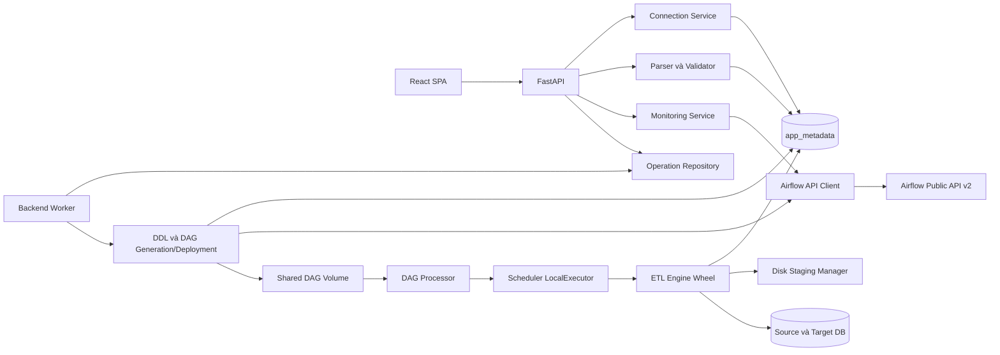

# Kế hoạch triển khai: Airflow Automation Tool

**Remediation T014 tiếp theo:** đưa cài đặt OS packages theo lock hiện có vào
stage `security-patched`, sau bản vá Brotli offline và trước runtime. Quét lại
stage/runtime bằng immutable IDs; không đổi upstream refs, constraints hoặc
thứ tự vá offline trước lệnh mạng đầu tiên. Chủ dự án đã cho phép commit/push
lên nhánh T014 để chạy CI; không merge main hoặc public deploy.

**Kiểm chứng14/11/2026:** T140 full startup/restart/fail-closed PASS trên Podman
client5.8.3/server5.8.9 Linux/amd64, Compose5.6.0; không suy Docker-tested.
T151 đã khép, hiện150/152tasks; T014_FULL/T152 vẫn BLOCKED. Build hardening nâng
wheel0.46.2/setuptools84.2.1 và bỏ rsync không dùng khỏi Airflow; constraints/core/SDK runtime giữ
baseline. Phạm vi scan21targets, source/image IDs, các regression và giới hạn tại
[lượt kiểm chứng](../../docs/testing/continuation-20261114.md).

**Remediation local2026-11-12:** scan mới phát hiện ba advisory HIGH của
git/git-man trong Airflow. Sản phẩm dùng local DAG volume/fixed wrapper, không
GitDagBundle hoặc git-sync; gỡ hai gói không sử dụng khỏi runtime cùng Docker
CLI. Giữ Airflow/core/SDK/locks và policy hiện hành. Build phải chứng minh không
còn git/git-man installed và pip check đạt; scan mới và packaged workflow thật
vẫn bắt buộc, không miễn advisory hoặc suy PASS từ image cũ.

**Sửa T143 về reservation (không đổi quota/retention):** sau khi raw file đã
được trích xuất đầy đủ, số dòng đã biết. Với FULL_REFRESH, reservation cho
mapped generation được chặn trên bởi `rows × MAX_ROW_BYTES + MAX_MANIFEST_BYTES`
và phần quota còn lại của run. Không xin toàn bộ 10GiB cho một file vài dòng.
Giữ nguyên giới hạn 10GiB/run, 20GiB/global, 1GiB free disk; không reclaim/xóa
artifact PROTECTED hay tự đóng authorization khi raw COMPLETE cần reconciliation.
Kiểm chứng bằng chuỗi real SDK: lỗi typed FULL_REFRESH giữ đích cũ và staging,
sau đó các run TXT nhỏ vẫn thực thi được trong cùng fixture/quota.

**Điều chỉnh đã duyệt2026-11-11:** build local portable theo
[quyết định](../../docs/decisions/portable-local-build-20261111.md), Constitution1.3.0.
Source/locks/config là đầu vào; IDs ghi provenance từng máy. Scan từng artifact
và đối chiếu findings với policy có hash approval, không cần baseline images máy
cũ. Không gọi đối chiếu này là cùng-snapshot delta; unknown findings vẫn BLOCKED.
Giữ hạn/controls, T014_FULL BLOCKED. Runner chuẩn bị manifest local dưới `.tools`.

**Làm rõ FR-067 đã được chủ dự án duyệt ngày2026-11-10:** giữ Airflow3.3.2.
Manual run của DAG paused chờ queued; operator phải xác nhận unpause riêng,
không tạm unpause ngầm hoặc tự bật cron. ONCE/SCHEDULED/BR-08 giữ nguyên.
Quyết định tại `docs/decisions/fr067-paused-manual-approval.json`; bằng chứng và
đề xuất tại `docs/proposals/fr067-paused-manual-run.md`.

**Hiện hành T021:** parser history ORM, conditional composite FK và revision cho ETag đã
kiểm47/47 trên PG cô lập; [báo cáo](../../docs/testing/t021-report.md),
[scope](../../docs/decisions/t021-local-scope.json). Data Model ghi rõ snapshot/hash/ETag
trước implementation. Chưa có binding/recovery safety hoặc parser API acceptance;
T029 phải chuyển các guards/FK sang Alembic thật. Chưa triển khai T022 trở đi.
T014_FULL BLOCKED/security FAIL; source-copy tests trên IDs đã duyệt, chưa build/scan/CI mới.
Các khối bên dưới là lịch sử.

**Hiện hành T020/T019:** definition ORM source và31PG checks PASS; TableDefinition thật đã
khép nhánh dependency còn thiếu của T019. [Báo cáo](../../docs/testing/t020-report.md),
[scope](../../docs/decisions/t020-local-scope.json). Chưa triển khai T021 trở đi.
Data Model làm rõ storage/parser snapshot, physical identity metadata và tagged defaults.
Create_all chỉ trong fixture; Alembic T029/foundation T034/build/scan/CI mới chưa nghiệm thu.
T014_FULL BLOCKED/security FAIL, không mở rộng approval. Các khối cũ dưới đây là lịch sử.

**Hiện hành T019:** ORM source và15PG checks PASS; chưa đóng task vì dependency-code positive
branch cần model nghiệp vụ thật ở task sau. [Báo cáo](../../docs/testing/t019-report.md),
[scope](../../docs/decisions/t019-local-scope.json). Không triển khai T020 trở đi.
Data Model bổ sung database_type snapshot cho ConnectionRevision theo FR-008, tránh sửa
parent type làm đổi run cũ. ORM guards phải được đưa vào Alembic T029; create_all chỉ ở fixture.
T014_FULL BLOCKED/security FAIL; images/services hiện hữu không thay, không mở rộng approval.

**Hiện hành T018:** source common schemas và health routing theo OpenAPI đã kiểm;
live200 ALIVE, readiness503 cho tới khi đủ gate T034. [Báo cáo](../../docs/testing/t018-report.md),
[scope](../../docs/decisions/t018-local-scope.json). Chỉ source-copy checks trên images đã duyệt,
chưa build/deploy source mới, không mở rộng ngoại lệ. T014_FULL BLOCKED/security FAIL.
T019 trở đi chưa triển khai. Scope các lượt cũ dưới đây giữ để truy vết.

**Hiện hành T017:** yêu cầu chủ dự án lượt tiếp theo cho phép riêng viết tests T017 theo
[scope](../../docs/decisions/t017-local-test-scope.json). Không mở rộng ngoại lệ security/image IDs.
Đã viết state/repository/concurrency/lock/role tests; collect/RED do T031 chưa có,
chưa triển khai T018 trở đi. [Báo cáo](../../docs/testing/t017-report.md).
Các scope “lượt này T015/T016” dưới đây là snapshot lượt trước; hạn local không thay đổi.

**Trạng thái hiện hành 2026-11-09:** chủ dự án đã khép LEX-003/D3 và duyệt mapping
ba candidate IDs. M0 PASS; quyền local chỉ T015/T016 lượt này đến2026-11-23 00:00 UTC+09,
review16/11. T014_FULL BLOCKED/security FAIL; CI source mới/full scan21targets NOT_RUN.
T015/T016 hoàn thành viết tests (harness9PASS, integration1PASS/6RED dự kiến).
Xem [activation](../../docs/decisions/t014-local-activation.json) và
[báo cáo](../../docs/testing/t015-t016-report.md). Không nghiệm thu foundation T034.

**Nhánh/ngữ cảnh Spec Kit**: `001-airflow-automation-tool` | **Ngày**: 2026-11-06
**Cập nhật thiết kế có mục tiêu**: 2026-11-08, sau Analyze bản152task; Git branch hiện tại `001-airflow-automation-tool-t014`.

**Đặc tả**: [spec.md](spec.md), đã Clarify, gồm 5 quyết định vòng đời FULL_REFRESH tại BR-08.
**Đầu vào bổ sung**: yêu cầu Plan17nhóm, Constitution1.1.0 và các finding Analyze cần đồng bộ
thiết kế. Bản Plan ban đầu chỉ tạo tài liệu; source/Compose và tiến độ implementation hiện
được ghi tại [tasks.md](tasks.md) và báo cáo Phase1. Workbook .xlsx hiện có được tái sử dụng.

## Remediation T014 đã duyệt — 2026-11-08

P1–P7 đã được chủ dự án duyệt; triển khai và nghiệm thu đang diễn ra theo
[phương án T014](../../docs/proposals/t014-remediation.md). Baseline bên dưới đã cập nhật
candidate được duyệt; build/runtime/security có kết quả riêng trong
`docs/testing/phase1-report.md`, không suy PASS từ bảng pin. T014 vẫn BLOCKED cho tới khi
đủ evidence security và CI; không đổi Constitution/BR-08 hoặc mở Phase2.

## A/B đã được chủ dự án duyệt ngày 2026-11-09

Tiếp tục T014 theo [phương án A/B](../../docs/proposals/t014-round2-approval.md).
A giữ nguyên Airflow3.3.2/core/SDK và file constraints upstream SHA256
`821effd0f491975682f2774fca3427d7bc2f59ca6de68dcb413ad2c8f890e58c`.
Constraints hiệu lực được tạo từ upstream, chỉ thay certifi2026.7.22→2026.10.18 và
urllib3 2.7.0→2.8.0; override artifacts khóa hashes riêng, kiểm resolver và pip check.
Không nối hai constraints xung đột hoặc sửa upstream. B dùng đồng bộ Playwright1.65.0,
image v1.65.0-resolute theo digest đã thử, Chromium158.0.8127.18, apt/libapt-pkg7.0
3.2.1ubuntu0.1. Cập nhật lock frontend/E2E và kiểm browser thực.
Podman6.1.1/Compose5.6.0 là tổ hợp đang tái kiểm trên máy hiện tại; không tự kế thừa
PASS baseline lịch sử. A/B không miễn trừ findings OS/build hoặc mở gate Phase1.

## Remediation bổ sung trong T014 — 2026-11-09

Theo quyền cập nhật dependency/base/toolchain trong hội thoại, bổ sung override
dnspython2.8.0→2.9.0 có hash/provenance riêng để vá CVE-2026-114605.
Toolchain gosu giữ Go1.27.3, chuyển Bookworm sang Alpine3.24 sau scan candidate
0 HIGH/0 CRITICAL; CGO_ENABLED=0 và source gosu1.19 bất biến.
Giữ core3.3.2/SDK1.3.2, upstream constraints bất biến; kiểm candidate cô lập.
[Phương án và giới hạn nâng core](../../docs/proposals/t014-round3-remediation.md)
phân biệt remediation được phép với đề xuất Airflow3.4 chưa được duyệt.

## Tóm tắt

Modular monolith với React/TypeScript SPA, FastAPI API và một backend-worker cùng codebase,
PostgreSQL application metadata và Airflow3.3.2 LocalExecutor. Airflow chạy ETL package wheel,
không dùng FastAPI request để chạy ETL. Excel1.0 điều khiển table/DAG/config/mapping, không
thực thi code. DB-to-DB snapshot một table → JSONL typed disk staging → validate → load batch.
Credentials mã hóa trong application DB, giải mã tại runtime qua keyfile riêng, không API response.

APPEND/UPSERT có target-native session lock và target transaction commit ledger; FULL_REFRESH
chuẩn bị dữ liệu trước rồi một transaction replacement, không TRUNCATE/DROP/ALTER table cũ.
Dashboard/history lấy Public API Airflow, không sao chép lịch sử vào app DB. Tất cả design
artifacts tiếng Việt; UI và workbook instructions tiếng Anh.

## Bối cảnh kỹ thuật

| Mục | Quyết định |
| --- | --- |
| Ngôn ngữ/runtime | TypeScript5.9.3, Python3.12; backend image3.12.16; Node22.23.4 build |
| Frontend | React/DOM19.2.0, Vite7.3.7, plugin-react5.1.1, Tailwind/@tailwindcss/vite4.1.18 |
| UI/data/form | shadcn CLI3.5.0, React Router7.18.5, TanStack Query5.90.10, RHF7.66.0, resolvers5.2.2, Zod4.6.7 |
| Backend | FastAPI0.136.3, Uvicorn0.38.0, Pydantic2.13.5, SQLAlchemy2.0.52, Alembic1.20.0 |
| IO/security | openpyxl3.1.5, defusedxml0.7.1, psycopg[binary]3.3.5, PyMySQL1.1.3, cryptography50.0.1, httpx0.28.1 |
| Orchestration | apache/airflow:slim-3.3.2-python3.12, LocalExecutor, Task SDK, Public APIv2 |
| Databases | postgres:17.11-bookworm, mysql:8.4.13 InnoDB/utf8mb4/strict mode |
| Web image | nginx:1.30.6-alpine3.24, SPA static và same-origin API reverse proxy |
| Kiểm thử | pytest8.4.2, Playwright1.65.0, DB/Airflow integration thật, schema/contract checks |
| Nền tảng | Linux/amd64 containers trên Podman WSL; client5.8.3/server5.8.9, Docker Compose provider5.6.0; named volumes cho IO. Docker baseline khác vẫn hợp lệ khi được công bố/kiểm theo Constitution1.1.0 |
| Phạm vi | Một operator local, không login;6màn hình,8hướng ETL; một source/target mỗi DAG |
| Hiệu năng | p95 list/detail/preview100dòng<=3giây trên fixture; connection<=30giây; registration<=120giây |
| Tài nguyên | ETL512MiB/process, parallelism2; staging10GiB/run/20GiBglobal; chi tiết runtime.md |

Pin baseline, nguồn và tradeoffs ở [research.md](research.md), bằng chứng registry ở
[dependency-verification.json](contracts/dependency-verification.json). Không dùng image latest.
Implementation phải tạo lockfiles/hashes, pin image digest thật sau resolve, chạy npm ci/build,
pip check/backend và custom Airflow. Metadata existence không thay test tương thích hoặc security scan.

## Kiểm tra Constitution

Gate trước nghiên cứu: mọi yêu cầu đầu vào nằm trong Constitution, không có vi phạm cần ngoại lệ.
Gate sau thiết kế dưới đây là đánh giá tính tuân thủ thiết kế, không phải test runtime đã PASS.

| Nguyên tắc | Bằng chứng thiết kế | Trước/sau thiết kế |
| --- | --- | --- |
| I Ngôn ngữ | Markdown tiếng Việt, UI/Excel tiếng Anh, API keys giữ chuẩn kỹ thuật | Đạt/Đạt |
| II Nhận diện/UI | Bố cục mới từ workflow, neutral icon/text, không screenshot/branding ngoài | Đạt/Đạt |
| III Spec Kit | Spec/Clarify→research→plan/data/contracts/quickstart, tasks để lệnh sau | Đạt/Đạt |
| IV Sản phẩm thật/đơn giản | Modular monolith, API/DB/Airflow thật, worker cùng image, không broker | Đạt/Đạt |
| V Metadata | Excel schema1.0, reusable factory/engine, validate/confirm trước side effect | Đạt/Đạt |
| VI Toàn vẹn/secrets | Native locks+ledger, policy riêng, encrypted revisions, không API password | Đạt/Đạt |
| VII Dữ liệu lớn | Snapshot streaming, typed disk staging/quota/recovery, không XCom dataset | Đạt/Đạt |
| VIII Airflow | LocalExecutor/TaskSDK/PublicAPIv2; revision registration; không internal DB nghiệp vụ | Đạt/Đạt |
| IX Linux containers | One-command init/migrations/seed/readiness/persistent volumes, không setup thủ công | Đạt/Đạt |
| X Kiểm thử | A–AM, failure injection, unit/integration/E2E/stress, chưa chạy không báo PASS | Đạt/Đạt |
| XI Tài liệu | Research/model/contracts/quickstart; README/architecture/troubleshooting implementation phải đồng bộ | Đạt/Đạt |
| XII Phân kỳ |8phase theo phụ thuộc, core trước polish; mỗi phase có gate kiểm chứng | Đạt/Đạt |

Rà soát sau Clarify: nguyên tắc VI còn được bảo vệ bằng ONCE reservation trước trigger,
admission/revoke serialize, ledger commit proof và allow_empty riêng; nguyên tắc III yêu cầu
đồng bộ task trước implementation. Các kết luận Đạt ở bảng là chất lượng thiết kế, không
phải reviewer checklist hoặc test runtime PASS. Bản152task đã đồng bộ sau Clarify;
lượt Plan2026-11-08 chỉ giao các điều chỉnh có mục tiêu ở cuối tài liệu cho bước Tasks.
Gate trước implementation vẫn cần Tasks đồng bộ lượt này, Analyze lại và reviewer đánh giá
checklist; không suy từ bảng thiết kế Đạt rằng gate triển khai đã mở.

## Cấu trúc dự án

### Tài liệu cho tính năng

```text
specs/001-airflow-automation-tool/
  spec.md
  plan.md
  research.md
  data-model.md
  quickstart.md
  contracts/
    openapi.yaml
    rest-api.md
    airflow.md
    runtime.md
    excel-definitions.md
    dependency-verification.json
    template-artifacts.json
  checklists/requirements.md
```

`tasks.md` chỉ sinh ở `/speckit-tasks`, không giả danh công việc đã thực hiện.

### Cấu trúc source dự kiến ở root

```text
frontend/src/{app,pages,features,components,lib}
backend/src/aat_api/{routes,services,workers,airflow_client,validation,ddl,deployments}
backend/alembic/
packages/aat_metadata/{models,repositories,secrets,runtime_views}
etl_engine/src/aat_etl/{contracts,readers,mapping,staging,loaders,recovery,metrics}
airflow/{dags,plugins,docker}
docker/{postgres,mysql,nginx,bootstrap}
templates/{Table Definition.xlsx,ETL Definition.xlsx}
samples/{definitions,data}
tests/{unit,api,integration,etl,airflow,e2e,stress}
docs/{architecture,operations,testing}
specs/
docker-compose.yml
.env.example
README.md
```

Thêm packages/aat_metadata để backend và ETL dùng repository/types/secret codecs mà không
import FastAPI vào engine. Đây là shared library trong monorepo, không service mới.
Backend imports metadata+engine contracts/adapters; engine imports metadata và SQL drivers;
Airflow wrapper imports SDK+engine. Engine/metadata không imports backend hoặc Airflow ORM.
Frontend chỉ qua OpenAPI-generated types/client và TanStack Query, không truy cập DB/Airflow trực tiếp.

## Kiến trúc module và hướng dependency



- Frontend Application: navigation/wizard, typed forms, previews và progress, không validation authority.
- Metadata Repository: transactions cấu hình, immutable revision/dependency, operations/audit/binding.
- Connection Service: CRUD/test/encrypt/sanitize/pooling/dependency/network allowlist.
- Excel Parser: openpyxl read-only, ZIP safety và cell provenance; Validator: version/schema/reference/type/key.
- SQL DDL Generator: PostgreSQL/MySQL adapter, logical types → SQLAlchemy Core constructs,
  dialect quote/literal defaults kiểm soát; no raw workbook expression.
- DAG Generator/Deployment: fixed wrapper, canonical config, atomic file, owner/revision/admission.
- Airflow API Client: JWT, timeout/pagination/backoff, registration/tasks/log, không internal DB.
- ETL Execution Package/Staging Manager: snapshot/stream/map/validate/load/commit recovery/quota.
- Monitoring Service: normalize Airflow read models, memory TTL30giây/completeness, không copy history.

Connection pool API metadata pool_size5/max_overflow5; external connection test NullPool,
connect10giây, tổng30giây. Runtime source/target connection riêng từng run, không kế thừa
SQLAlchemy pool qua scheduler fork; create sau task start, close tại end. Không log DSN/password.

## Thiết kế Compose và runtime container

| Service | Image/code | Phụ thuộc/readiness | Volume/trách nhiệm |
| --- | --- | --- | --- |
| secrets-init | backend image bootstrap | one-shot, restart no | Tạo một lần key/DB passwords/JWT/runtime token trên private volumes, không in secret |
| postgres | postgres:17.11-bookworm | secrets-init completed; SELECT1 thật | pg_data; app_metadata/airflow_metadata/etl_test |
| mysql | mysql:8.4.13 | secrets-init completed; SELECT1 thật | mysql_data; etl_test, InnoDB/utf8mb4 |
| db-init | backend image | DBs healthy, one-shot | Tạo DB/users/grants idempotent, sample support objects; bootstrap secrets |
| app-init | backend image | db-init completed | Alembic+seed connections/data/files/templates metadata, owner migration lock |
| airflow-init | custom Airflow image | db-init completed | airflow db migrate, SimpleAuth users, config keys; không app tables |
| airflow-apiserver | custom Airflow image | airflow-init completed | api-server port8080, JWT/auth files, logs read |
| airflow-scheduler | custom Airflow image | airflow-init completed | LocalExecutor process tasks, DAG read/uploads read/staging write/logs/key/runtime DSN |
| airflow-dag-processor | custom Airflow image | airflow-init completed | DAG read, parse; no app database password access nếu không cần |
| backend-worker | backend image | app-init completed | Durable validation/DDL/deploy/reconcile/cleanup, DAG write/uploads/staging, heartbeat |
| backend | backend image | app-init completed, worker ready, Airflow ready | port8000, metadata/API/config, không ETL background process |
| frontend | nginx static build | backend healthy | port80→host3000, /api/v1→backend:8000 |

Không Celery/Redis/worker container ETL riêng vì LocalExecutor dùng scheduler. Không triggerer
vì không dùng deferrable operator. Các service dài hạn restart unless-stopped; init restart no,
thất bại phải báo rõ thay vòng lặp reset dữ liệu. depends_on service_healthy hoặc
service_completed_successfully theo loại; startup không phụ thuộc sleep cố định.

Network `aat_internal` bridge; DB không publish host port theo mặc định. Chỉ expose
127.0.0.1:3000/8000/8080. Browser dùng localhost; backend dùng postgres:5432/mysql:3306,
Airflow API airflow-apiserver:8080; Airflow Execution API cấu hình URL nội bộ api-server.
Generated DAG/deep link không dùng hostname container làm browser URL.

Private runtime dùng URL canonical `http://backend:8000/internal/runtime/bind` ngoài router
public `/api/v1`. Operation OpenAPI đã có server override; nhận định Analyze rằng thiếu
override là sai và được rút lại. Nginx trả404 cho cả `/internal/runtime` và
`/api/v1/internal/runtime` cùng path con trước API proxy/SPA fallback, không redirect.
Không tạo alias private dưới public prefix; runtime gọi backend trực tiếp bằng bearer.
Gate T005 tương lai kiểm cả hai biến thể qua frontend kể cả bearer hợp lệ, không có
request upstream; canonical trực tiếp thiếu/sai bearer bị401/403, public alias luôn404.

Named volumes: pg_data, mysql_data, generated_dags, airflow_logs, uploads, staging,
app_keyring/runtime_secrets, backend_secrets, airflow_secrets, bootstrap_secrets.
Secrets chia domain và mount chỉ đọc vào service cần; bootstrap DB admin key không mount
vào task runtime. UID/GID permissions tự thiết lập trong init, không chmod toàn bộ777.
DAG writer chỉ backend-worker; dag-processor/scheduler read-only. Local files dùng Linux
named volumes tránh disk IO/permission Windows bind mount; templates immutable trong image.

ENV có default local để một lệnh chạy mà không cần copy .env: app URLs, DB names/service
hosts, Airflow version/executor/parallelism, resource limits/retention. Secrets tạo an toàn
trên volume, optional *_FILE overrides; .env.example chỉ hướng dẫn, không commit key thực.
Airflow SQL connection/signing/auth config được nạp từ secret file trong bootstrap/entrypoint,
không nhúng vào DAG hoặc API response. Thiếu key ở DB đã mã hóa làm readiness fail, không regenerate.

Health: frontend static/proxy; backend /api/v1/health/ready kiểm migration/head+app DB+
worker heartbeat+Airflow functional ready; external ETL connections trạng thái riêng.
Airflow API /api/v2/monitor/health phải kiểm JSON metadatabase/scheduler/dag_processor;
scheduler/dag-processor có heartbeat CLI check tương ứng. Cần tách liveness khỏi aggregate
readiness để tránh restart cascade chỉ vì dependency tạm down.

db-init không chỉ initdb.d: mỗi startup kiểm DB/role tồn tại bằng query và CREATE thiếu ngoài
transaction phù hợp; app/Airflow migrations chạy đúng owner và locks. Seed chỉ insert natural
key thiếu, không overwrite dữ liệu người dùng. Dữ liệu mẫu thuộc namespace riêng; restart
volume có dữ liệu phải giữ app revisions/files/DAG/log và cleanup chỉ theo retention đã đối soát.

## Thiết kế workflow và các hợp đồng

### Connections, Excel và DDL

Connection Service dùng metadata revision/secret records, DB error classification theo SQLSTATE/
PyMySQL exception; không trả raw exception chứa DSN. Validate host allowlist trước DNS/connect,
resolve địa chỉ không cho chuyển sang endpoint ngoài allowlist sau rebind. Local allowlist mặc
định postgres/mysql; operator cấu hình DB bên ngoài rõ ràng, không tuyên bố là SSRF-safe public app.

Table workbook chọn target connection, parser trả cell provenance và structured issues. Validation
hoàn chỉnh workbook trước confirmation; SQLAlchemy Core constructs/dialect adapters compile
CREATE TABLE và quote identifiers, default chỉ typed literal. Composite PK theo ordinal, no ALTER/
DROP. Worker execute từng table, kiểm lại quyền/existence ngay trước DDL; MySQL implicit commit
nên không transaction toàn workbook. Kết quả/table ledger xử lý runtime partial, không rollback
ngầm table đã tạo. Sample namespace tách dữ liệu người dùng.

Template1.0 đã có file thực ở templates và samples/definitions,4workbooks được openpyxl mở lại
kiểm tra. Header/required/conditional/default/cross-sheet/version/error quy định ở
[excel-definitions.md](contracts/excel-definitions.md). Download endpoint chỉ serve artifact đã
version/hash; không cho template download phát sinh execution. Endpoint chưa triển khai ở Plan.

### DAG và Airflow

Fixed factory tạo một file wrapper/DAG từ canonical JSON; file chỉ import SDK/controlled
ETL function, DAG metadata và IDs/hash, không secret/Python expression từ cell.
Mỗi DAG execute_etl có max_active_runs1, catchup false, cron/manual và timezone IANA đúngSpec.
Metadata package revision immutable, Airflow task bind qua backend xác minh TI.dag_version,
không request lưu password rồi trả cho task. Secrets runtime lookup không cần restart Airflow.

Local bundle update phải pause+admission gate+drain cả queued/running; runtime kiểm lại gate/
revision để chặn race scheduled run. Worker atomic deploy, poll registration/errors/versions,
120giây kết quả hoặc chưa xác minh, không fixed sleep/success giả. DAG mới paused; full refresh
activation cần authorization đúng target/revision. Old clear sau redeploy bị reject revision mismatch.
Hợp đồng chính xác API/log/token ở [airflow.md](contracts/airflow.md).

### Engine, type và load

[Runtime contract](contracts/runtime.md) chốt format `aat-jsonl/1`, snapshot PG/MySQL,
chunk/batch/byte limits, lossless NULL/Unicode/Decimal/temporal, path/run/attempt và failure recovery.
DB-to-DB extraction hoàn tất trước target ghi; File-to-DB streaming format validation gắn checksum,
full-refresh toàn mapped dataset phải hoàn tất trước replacement. No fetchall/whole dataset RAM/XCom.

Target support DDL chỉ create technical objects sau consent/preview, sample init chuẩn bị;
không tự ALTER user schema. Ledger batch/final cùng transaction target là bằng chứng commit,
app DB metrics chỉ projection. Cùng session native lock và writer ngăn alias/concurrency.
APPEND retry skip commit marker có checksum khớp; UPSERT chosen-key đúng dialect; FULL_REFRESH
DELETE được ủy quyền+insert chunks+verify+marker trong một transaction, giữ old khi fail.
Không autocommit TRUNCATE, rename swap hoặc tắt constraint để đơn giản hóa.

Mọi resource retry có deadline/count và loại lỗi: transient+chứng minh safe mới retry;
validation/type/key/authorization/storage corruption không infinite retry. Kill/commit lost
đối soát server session/ledger/binding trước acquire/replay/cleanup; heartbeat alone không đủ.
Metrics dòng đếm source accepted không dialect affected_rows, đối soát theo strategy, không live count sai snapshot.

### Vòng đời FULL_REFRESH và ranh giới thu hồi

[Data Model](data-model.md) tách Authorization, RunIntent, ExecutionBinding và
ReplacementAdmission. ONCE reservation gắn run_uuid/Run ID ổn định trong transaction cùng
Operation ngay khi tiếp nhận trigger, trước POST Airflow; không dùng TI binding giả khi run
chưa tồn tại. Idempotency replay cùng request trả intent cũ, không cấp quyền cho Run ID mới.
ONCE terminal success → consumed; failure hết retry/canceled đã xác minh → closed; commit
chưa rõ giữ recovery. Không release reservation vì timeout/heartbeat stale.

SCHEDULED chỉ Airflow `run_type=scheduled` trong scope DAG/revision/physical target/strategy/
schedule/timezone/start date/catchup đã xác nhận. Manual trigger/rerun mới dùng ONCE riêng;
activation lịch FULL_REFRESH cần SCHEDULED. allow_empty=false mặc định, true cần acknowledgment
riêng theo cùng scope; đổi scope/revocation invalidates quyền cũ, lỗi nguồn không là empty.

Runtime đã bind giữ native target lock, đối soát final ledger và validate toàn mapped dataset.
Repository app DB khóa authorization row, rồi intent/binding/admission theo lock order chung;
commit admission ngắn là điểm chấp thuận replacement, sau đó mới bắt đầu target transaction.
Revoke khóa cùng row: revoke commit trước admission thì chặn, sau admission thì transaction đã
chấp thuận có thể hoàn tất/rollback. Không giữ app transaction trong ETL, không tuyên bố atomic
app DB/target. Mất phản hồi admission phải đọc lại identity trước ghi; mất target COMMIT dùng
ledger đối soát. Retry sau rollback cần admission epoch mới/quyền còn hiệu lực; commit VERIFIED
chỉ trả kết quả đã có, không replacement lần hai. Runtime role không được cấp/sửa scope quyền.

UI có list/detail/revoke quyền, hiện reservation/state/acknowledgments/replacement_in_progress,
nhãn unknown khi chưa xác minh; thông báo rõ revoke không cancel giao dịch đã admission.
Các public fields không credentials; authority commit vẫn ở target ledger, không ở response.
Quy trình/ca kiểm chứng chi tiết nằm ở [runtime.md](contracts/runtime.md) và [quickstart.md](quickstart.md).

### Dữ liệu UI và API lịch sử sau Analyze

Contract bổ sung dependency refs cho Connections, typed table columns/default/PK/config,
last_successful_run có availability, run/task errors và recovery metrics. History GET đọc
upload/jobs/table detail phân trang từ metadata bền, không dựa ID browser. Parser PATCH tạo
revision immutable trên cùng content, If-Match, block active/recovery và invalidate dependency;
preview có thể đọc cấu hình dự kiến không lưu. Workbook1.0 không đổi schema hoặc sample bytes.
Tên ledger vật lý thống nhất `_aat_control.*` ở PG và `_aat_batch_commits`,
`_aat_run_commits`, `_aat_support_schema_version` ở MySQL; init/runtime dùng chung signature.

### Frontend UI/UX

Ứng dụng mới có sidebar nền trung tính đậm, vùng nội dung sáng, accent xanh lam; tên Airflow
Automation Tool dạng chữ và icon trung tính dự án, không logo bên thứ ba. Desktop-first,
sidebar thu gọn ở390px, bảng scroll trong vùng chứa, focus/keyboard và form labels đầy đủ.
Dùng shadcn components đã commit source và Tailwind tokens thống nhất; không phụ thuộc ảnh mẫu.

| Trang | Bố cục và hành động |
| --- | --- |
| Dashboard |8KPI cards, date/timezone/refresh toolbar, schedule groups, SVG charts từ số liệu thật, recent runs |
| Connections | Search/filter table, detail drawer, form Add/Edit, Test result/time, dependency warning |
| Table Management | Wizard upload→issues→table/SQL preview→confirmation→per-table progress/history |
| DAG Builder | File Sources panel + wizard Definition→dependencies/mapping→schedule/load→confirm→deployment progress |
| DAG Monitoring | Ownership badge, DAG list/details, run/task history, logs drawer, trigger/pause/open Airflow |
| Settings | Default values với unit/range, connectivity read-only, application info |

React Router declarative routes /, /connections, /tables, /dag-builder, /monitoring, /settings.
TanStack Query quản lý server state, invalidation và polling, không optimistic success cho DB/
Airflow side effects. RHF+Zod field rules; Backend authoritative validation trả cell issue table.
Confirmation hiển thị exact target/revision/load consequences; FULL_REFRESH allow_empty riêng.
Empty/loading/error/stale/partial/unknown là trạng thái riêng; external DAG metrics missing là
Not available. UI copy tiếng Anh; tài liệu kiến trúc và hướng dẫn Markdown tiếng Việt.
Không dùng mock dashboard thay kết nối thật; fixture chỉ unit/UI isolation và được gắn rõ.
Charts SVG code-native đơn giản, không thêm thư viện chart chưa pin hoặc tạo bitmap mockup.

### Backend API và công việc nền

[REST API](contracts/rest-api.md), [OpenAPI3.1](contracts/openapi.yaml) định nghĩa contracts hiện tại,
requests/responses/errors/async contracts. API uploads streaming rồi worker parse/validate,
DDL/deploy/trigger202với Operation/idempotency. Public errors tiếng Anh với request_id/code/
location, không stacktrace/credentials/path. ETag/If-Match chống lost update; confirmation signed
10phút gắn hashes và dependency fingerprints, stale thì validation lại.

Same backend image chạy worker riêng process, Operation lease/reconcile bền qua restart.
Worker không chạy ETL hoặc cron thay Airflow; housekeeping chỉ dọn artifact/durable job.
Public API unauthenticated local nhưng origin/CORS/mutation protection; /internal/runtime/bind
service token chỉ nội bộ và không proxy qua frontend. Connection/password input write-only,
không endpoint secret export. OpenAPI runtime phải kiểm drift so với contract đã thiết kế.
Số operation/schema được lấy từ artifact đã validate, không hardcode baseline40 trong test/
codegen. Bổ sung API ở Plan chưa là endpoint đã triển khai; task/client/tests phải cập nhật
theo cùng contract trước khi tuyên bố integration hoàn thành.

## Chiến lược kiểm thử và bằng chứng

| Tầng | Công cụ/phạm vi | Bằng chứng cần lưu |
| --- | --- | --- |
| Unit | pytest: parser/type/filter/DDL/config serialization/state policy; frontend form/component isolated | Cases/error locations, DDL fixtures hai dialect, không nhận thay integration |
| API contract | pytest/httpx và OpenAPI validation | write-only secrets, extra fields reject, status/ETag/idempotency/confirmation |
| DB integration | PostgreSQL17/MySQL8.4 thật | DDL/PK ghép/transaction/collation/key/update conflict/ledger atomic |
| ETL | Engine trực tiếp và task trong Airflow |8routes, NULL/Unicode/decimal/CSV quote, value/count reconciliation |
| Airflow | Image3.3.2 và APIv2 thật | Import errors, parsed revision, TI version, manual+cron, pause/trigger/log pagination |
| Failure/recovery | Kill/network/commit-response-loss/disk full/schema drift | No blind replay, full-refresh rollback, same-target native lock, protected cleanup |
| Container startup | Fresh volumes/restart/migration failure | One command, real health, seed idempotent, secrets/volumes bền |
| E2E | Playwright1.65.0 against real stack | Upload→preview→create/deploy→run→monitor/dashboard/open Airflow; desktop1440/mobile390 |
| Stress | Dataset>1GiB, worker budget512MiB, >20batches | RSS/actual disk/manifest/checksums/row counts/cleanup, không đọc toàn RAM |

Spec A–AM là ma trận bắt buộc; group A/B/P/AL cho Excel/table; C–H/U cho8routes;
I/J/K/L/M/AC/AE/AG cho mapping/load/integrity; N/T/W/AJ/AK cho Airflow;
O/R/V/AA/AD/AH/AI cho streaming/failure; S/Z cho monitoring/UI; Q/X/Y/AB/AF/AM cho
connections/security/drift/startup. Không bỏ case đã nêu vì ưu tiên thấp.

Mỗi kết quả ghi commit/build/lockfile/image digest, command, resources, input/checksum,
expected/actual values, trạng thái chạy và artifact. Chưa chạy là NOT_RUN, bị chặn là BLOCKED,
không đưa vào tỷ lệ PASS. Plan chưa build app hoặc chạy test sản phẩm; workbook/schema checks
ở bước thiết kế chỉ xác minh artifact, không chứng minh nghiệp vụ ETL.

Gate BR-08 thêm: ONCE double reservation/idempotency/trigger timeout, retry extraction giữ
quyền/run terminal đóng quyền/rerun mới, scheduled vs manual/backfill, allow_empty acknowledgment,
revoke trước/sau admission, admission-response-loss, target COMMIT-response-loss, retry/clear
run success không replacement lần hai. Test revoke/admission barrier bằng transaction thật,
không chỉ unit mock; báo cáo ghi cùng run/intent/admission/ledger identities không secret.

## Các giai đoạn triển khai và tiêu chí ra giai đoạn

Đây là8phase implementation dự kiến, không phải trạng thái đã hoàn thành. Bước Spec Kit Plan
chỉ kết thúc research/design; việc phân task chi tiết thực hiện sau bằng /speckit-tasks.

| Phase | Phụ thuộc | Đầu ra | Gate nghiệm thu thực |
| --- | --- | --- | --- |
|1 Setup/Containers | Không | Monorepo/images/locks/Compose/secrets-init/DB-init/Airflow services/health; test profile và runner tối thiểu | resolve/build/pip check/npm build; một lệnh lên DB/Airflow khỏe; startup lại giữ volumes; không secret committed; runner pytest/Playwright khởi chạy và collect được bootstrap/smoke tests phù hợp |
|2 Backend/metadata |1 | API shell, Alembic, repositories/revisions/Operation worker, seed | schema/repository constraints và isolation app/Airflow DB; migrations/seed idempotent; Operation lease/idempotency/recovery; foundation liveness/readiness; chưa nghiệm thu Connections CRUD hoặc Settings API |
|3 Connections |2 | CRUD/test/encryption/dependency/network rules/runtime lookup | PG/MySQL test thật và lỗi; revision/secret không leak; không cần Airflow restart khi tạo connection |
|4 Excel/table |3 | Parser/schema1.0/template downloads/validation/DDL/create/history | A/B/P/AL; workbook nhiều table/PK ghép, invalid side-effect-free, partial DDL result hai DB |
|5 ETL/staging |3,4 | Engine wheel, readers/map/staging/locks/support ledger/load/recovery |8routes chạy trực tiếp trên DB thật; stress/quota/commit loss/UPSERT/FULL_REFRESH failure tests |
|6 DAG integration |5 | Factory/atomic deploy/API client/admission/revision/bind/manual+cron | Airflow parse/register đúng revision+execute ETL thật; pending/parse/API errors; old-clear reject |
|7 Dashboard/Monitoring |6 | Public API aggregates/pagination/tasks/logs/control links | S/T/W/AJ/AK, state/timezone/lifetime/incomplete chuẩn, không query metadata nội bộ |
|8 Frontend integration/stabilize |4–7 | Sáu trang hoàn chỉnh, docs/README/troubleshooting, mở rộng runner và regression E2E đã có | Playwright real stack A–AM coverage; ngôn ngữ/responsive; security/performance/recovery evidence; T014_FULL phải PASS trước khi claim MVP/full acceptance, nếu BLOCKED thì chỉ báo cáo BLOCKED |

Phase1 có bootstrap tối thiểu DBs/Airflow; phase2 bổ sung application migrations/seeds đầy đủ,
không yêu cầu phase1 đã có sản phẩm hoàn chỉnh. UI shell tối thiểu được dựng từphase1 và forms
của module đi cùngphase3/4/6 khi cần demo; phase8 tích hợp/polish, không chờ cuối mới bắt lỗi API.
Phase5 trực tiếp gọi engine với fixtures thật trước khi factory hoàn chỉnh, tránh dependency vòng.
Core status/log/validation/security đi cùng từng phase, không dời hết sang Monitoring/polish.

Đầu ra engine preparation trước writers chỉ được nghiệm thu snapshot/staging/mapping và
interfaces, không yêu cầu target load thật khi policy chưa tồn tại. Sau writers/dispatch mới
chạy standalone transfer/failure/metrics verification; Tasks phải tách các checkpoint này
để không tạo dependency vòng vì tiêu chí hoàn thành vượt phần đã triển khai.

Compose profile `test` có `backend-tests` và `e2e-tests` từ Phase1, không khởi động mặc định.
Skeleton gồm Dockerfile backend tests copy root tests, Playwright Dockerfile/config, manifest/
lock `@playwright/test==1.65.0` và image `mcr.microsoft.com/playwright:v1.65.0-resolute` cùng
browser version; code tests gọi `http://frontend:80` trong network Compose. Runner chạy được
bootstrap/shell smoke phù hợp hiện có; collect/runner smoke không chứng minh story đã PASS.
Phase2 mở rộng fixture metadata và harness contracts; Phase3 dùng runner này nghiệm thu
Connections E2E trước gate sang Phase4. Phase8 chỉ mở rộng full regression, không tạo lần
đầu runtime/config bắt buộc cho các gate trước. Chọn selector theo phase, không yêu cầu
endpoint tương lai PASS và không dùng skip để tuyên bố story hoàn thành. Quickstart cung cấp
lệnh container nên không cần cài Python/Node/browser trên host để chạy suite đã hỗ trợ.
Fixtures dùng Compose project/volumes và table/DAG namespace riêng theo lượt; cleanup chỉ
tài nguyên test sở hữu, không dữ liệu người dùng. Image client/browser phải resolve/pin và
kiểm version tại build; version trong thiết kế chưa là bằng chứng image đã chạy.

### Bytes và EOL của dataset mẫu

CSV/TXT mẫu trong Git index dùng LF; checkout hiện tại trên Windows dùng CRLF nên SHA256
raw khác [design-validation.json](contracts/design-validation.json). Đổi CRLF về LF trong
bộ nhớ để chẩn đoán khớp hash cũ cho cả hai file; không sửa dataset trong lượt Plan này.
Implementation phải thêm `.gitattributes` với `samples/data/*.csv text eol=lf` và
`samples/data/*.txt text eol=lf`, giữ `.xlsx` binary (`*.xlsx -text`), rồi tạo checkout sạch
hoặc materialize lại riêng sample paths sau khi bảo toàn thay đổi người dùng. Không dựa vào
`core.autocrlf` riêng của developer. CI kiểm working-tree sample bytes chỉ LF và SHA256 raw
khớp manifest trên Windows/Linux trước đóng image/seed; seed tính hash bytes thực được copy
vào volume, không hardcode hash nếu bytes khác. Bằng chứng hiện có là lịch sử LF, không
chứng minh bytes của checkout Windows hiện tại đã khớp. Thay chính sách EOL không cho phép
normalize file upload của người dùng; content immutable/hash/byte count tính trên bytes lưu.

## Theo dõi độ phức tạp và kết luận thiết kế

Không có ngoại lệ Constitution cần phê duyệt. Backend-worker cần để job bền qua request/restart;
shared metadata package tránh coupling FastAPI/runtime; target ledger cần để chứng minh commit,
không phải mở rộng thành microservices. MySQL UPDATE+INSERT và LocalDagBundle drain/version
checks phức tạp hơn shortcut nhưng bảo vệ correctness đã yêu cầu.

Các rủi ro phải kiểm đầu implementation: dependency resolver giữa image và wheel, quyền target
support DDL, MySQL collation/key validation, native lock/session loss, old-clear LocalDagBundle,
first-boot secrets/DB ordering, RSS giới hạn thực trên LocalExecutor. Nếu gate fail phải sửa thiết
kế/documented pins và kiểm lại, không đánh dấu phase hoàn thành. Không có lựa chọn blocking
chưa chốt; dữ liệu stress/benchmark và image digest là bằng chứng phải tạo ở implementation.


## Kết quả kiểm chứng artifact tại bước Plan trước lượt 2026-11-08

- 4workbook thực tế đã được mở lại, kiểm version/header, data validation, không formula,
  cross-sheet sample references và checksum;2dataset CSV/TXT đã parse4record/file bằng parser chuẩn.
- Lượt Plan ban đầu: OpenAPI3.1 có40operations/40schemas, đã chạy openapi-spec-validator0.7.2.
  Lượt đồng bộ sau Clarify mở rộng contract; xem kết quả kiểm chứng hiện tại thay vì coi
  con số ban đầu là hợp đồng bất biến.
  Lượt đồng bộ sau Clarify (ghi nhận lịch sử): OpenAPI47operations/53schemas hợp lệ với validator0.7.2;29schema cases
  đúng/sai đạt cho authorization acknowledgment, source union, mapping/filter, load keys,
  typed literals và required UI fields. Đây là schema validation, không phải runtime tests.
- Registry verification23package/image entries thành công; peer metadata7package phù hợp
  baseline React19/Vite7/Node22/RHF7. Dữ liệu gốc ở [peer-dependencies.json](contracts/peer-dependencies.json).
- Không có broken local links hoặc placeholder chưa xử lý tại lần kiểm cuối; bằng chứng
  [design-validation.json](contracts/design-validation.json). Đây không phải test ứng dụng.
- Chưa tạo application source code, Compose/Dockerfiles/migrations/locks thực thi ở Plan;
  chưa build image, boot stack, benchmark hoặc chạy ETL/E2E. Các gate runtime còn phải thực hiện.
- Không có extension hooks cấu hình ở thời điểm hoàn tất. Sẵn sàng cho /speckit-tasks.
  Đã kiểm31local links trong các Markdown được cập nhật: không broken links;4workbook và
  2dataset hashes khớp bằng chứng cũ, không chỉnh binary templates/samples.

## Lịch sử đồng bộ sau Clarify

- A1: thiết kế reservation/admission/revoke/ONCE/SCHEDULED/allow_empty đã đưa vào Research,
  Data Model và Runtime/Airflow/API; Spec không bị đổi nghiệp vụ ở bước này.
- F1/E1/F3/F4: contracts bổ sung dữ liệu UI/history/parser revision và tên technical ledger
  thống nhất. Đây là thiết kế cần được implementation/test, không phải findings đã PASS runtime.
- Các ID/findings trong lượt137task là lịch sử. Bản152task đã tách preparation T081,
  metrics T082 và recovery/dispatch T090/T092; đã bổ sung models, authorization/history/
  parser APIs và BR-08 tests. Không coi các yêu cầu đồng bộ đó là chưa làm ở trạng thái hiện tại.

## Kết quả rà soát có mục tiêu ngày 2026-11-08 và bàn giao Tasks

I1 được rút lại ở phần thiếu server override: override đã tồn tại; cập nhật chỉ làm rõ
canonical route, router boundary và ma trận chặn proxy. D1/I2 được xác minh từ gate E2E
trước T138 và gate Phase2 đòi API ở phase sau. I3 được xác minh bằng raw SHA256 và EOL
Git index/working tree. A1 là tên ca kiểm thử không có policy tương ứng: BR-08/model/API
không có authorization TTL/EXPIRED; giữ revoke/invalidate/terminal states, không thêm TTL.
Confirmation token10phút hết hạn không thu hồi quyền hoặc giải phóng ONCE; replay cùng
request vẫn trả intent cũ. Không cần Clarify vì không đổi nghiệp vụ; nếu muốn TTL trong
tương lai phải Clarify trước. I4 được xử lý bằng tách lịch sử khỏi trạng thái hiện hành.

Constitution sau cập nhật: III/XI đạt ở phạm vi thiết kế vì các quyết định và bàn giao
được ghi rõ; IV/VI đạt về thiết kế private bearer/router và giữ nguyên BR-08; IX/X/XII
đạt về thiết kế bootstrap/product readiness, runner sớm và gate độc lập. Không có ngoại lệ
Constitution; kết luận này không xác nhận runtime, reviewer approval hay Tasks đã đồng bộ.

Bước `/speckit-tasks` tiếp theo phải cập nhật có mục tiêu, dùng ID152task hiện tại làm mốc:

1. T005: hai prefix private trả404 qua frontend, không upstream/SPA fallback; direct
   canonical kiểm bearer/identity, direct public alias404. Đồng bộ T103/T104 với canonical.
2. Đưa phần tạo test profile/Playwright Dockerfile/config/lock của T138 lên Phase1 trước
   E2E đầu tiên; T138 chỉ mở rộng regression. Ghi prerequisite cụ thể cho consumer, tránh
   thêm cạnh ngược từ T046 về T138 gây cycle. Phase2 chỉ foundation; Phase3/7 mới CRUD/Settings.
3. Gắn T098 làm prerequisite trực tiếp hoặc bắc cầu của ETL template consumer (T120);
   đưa T069 vào chuỗi nghiệm thu Phase5 và bảo đảm T152 có đường dependency tới cả hai.
4. T145 thay `authorization expired` bằng revoked/invalidated trước admission và kiểm
   recovery sau revoke. Phân biệt test confirmation token hết hạn với replay cùng key/hash;
   không tạo EXPIRED/TTL hoặc giải phóng reservation.
5. Bổ sung truy vết NFR-005 ở mapping/load/recovery tests phù hợp, không tạo nghiệp vụ mới.
6. Thêm đầu ra `.gitattributes`, kiểm sample LF/raw hashes trước build/seed, giữ XLSX binary;
   cập nhật status tài liệu cần thiết, không tự sửa checkbox reviewer.
7. Giữ 8phase, dependency IDs/gates và test-before-implementation nhất quán; nếu đánh lại
   ID phải cập nhật mọi tham chiếu. Không dùng ID137task làm prerequisite hiện tại.

Lượt này giữ nguyên `tasks.md`, Spec/BR-08, Constitution, Data Model, checklist và binary/
dataset mẫu. Sau đồng bộ Tasks phải Analyze lại và reviewer xử lý checklist trước Implement.
Thống kê trong `checklists/requirements.md` còn là lượt cũ (87FR/14BR/12SC/A–Z); Spec hiện
có100FR/22BR/15SC/A–AM. Chủ sở hữu Specify/Clarify cập nhật ghi chú đó khi phù hợp; không
coi16checkbox hiện có là chứng minh checklist đã được rà soát lại cho mọi thay đổi mới.

### Kiểm chứng tài liệu trong lượt này

- Chạy `setup-plan.ps1 -Json` bằng PowerShell process với ExecutionPolicy Bypass,
  `SPECIFY_FEATURE_DIRECTORY=specs/001-airflow-automation-tool` và
  `SPECIFY_FEATURE_NO_PERSIST=1`: resolve đúng Spec/Plan hiện có, không chép đè template
  hoặc tạo feature.json. Ngữ cảnh feature001, Git branch hiện tại `001-airflow-automation-tool-t014`.
- Script Python standard library chỉ đọc: kiểm28local Markdown links trong6file Markdown
  đã sửa, không broken links;8phase còn nguyên;47operation IDs/53schema declarations.
  Toàn bộ phần `components` OpenAPI không đổi so với HEAD; server override private tồn tại
  cả trước/sau. OpenAPI chỉ bổ sung description, không đổi schema/URL/security.
- SHA256 của4workbook khớp manifest lịch sử. Dataset CSV/TXT raw hashes lần lượt là
  `91b62e717c072844533bf451c242107e193bacce0b7fe6adbd9ba827a5f479fd` và
  `77b52a76946d08d1733973ce7bf43e0ef37cfc2506114df15833d39793d292bf`;
  mỗi file có6CRLF, chuẩn hóa trong bộ nhớ khớp hash LF lịch sử. Sample bytes không đổi.
- `git diff --check` không lỗi; chỉ7file thiết kế/contracts thay đổi. Spec, tasks, Data
  Model và hai checklist không đổi nội dung so với HEAD. Không có extension hooks cấu hình.
- Không có PyYAML/jsonschema/openapi-spec-validator trong Python hiện tại nên chưa chạy
  lại YAML/OpenAPI schema validator. Đếm cấu trúc và so components không thay validator.
  Chưa build image, resolve dependencies, chạy nginx/backend/Compose/pytest/Playwright hoặc
  CI Windows/Linux. Mọi kiểm chứng runtime và EOL checkout sau implementation đều NOT_RUN.

## Baseline Podman đã duyệt ngày 2026-11-08

Constitution1.1.0 đã được chủ dự án duyệt theo [bản sửa](../../docs/proposals/podman-support.md).
Baseline hiện chọn Podman client5.8.3/server5.8.9, WSL Linux/amd64, cgroupv2, rootful,
provider Docker Compose5.6.0. Chỉ engine/provider đã phản hồi; build/stack compatibility
vẫn NOT_RUN. Các ghi nhận Plan/implementation trước sửa đổi giữ nguyên là lịch sử.

- Lệnh canonical: `podman compose up --build -d`; Docker baseline có thể dùng lệnh tương
  ứng nhưng không được quảng bá đã được kiểm từ kết quả Podman. Giữ `docker-compose.yml`,
  Dockerfiles và thư mục `docker/`; không đổi topology hoặc tách thêm stack riêng.
- Preflight trước T002: engine/provider thật, registry access, Linux/Python3.12/amd64,
  cgroupv2 và resources. Pin provider qua `PODMAN_COMPOSE_PROVIDER` trỏ executable thực đã
  kiểm; ghi client/server/provider trong báo cáo. Không âm thầm đổi provider giữa lượt chạy.
- Dùng fully qualified image refs, ví dụ `docker.io/library/postgres:17.11-bookworm`,
  `docker.io/apache/airflow:slim-3.3.2-python3.12`; giữ version, resolve digest thật tại T014.
- Provider phải thực hiện service_healthy/service_completed_successfully, one-shot failure
  chặn consumer và profiles; phải kiểm thực, không thay bằng sleep hoặc YAML parse đơn thuần.
- Named volumes nằm trong Linux VM, UID/GID/RO mounts và secret domains như thiết kế hiện
  có; rootful engine không cho phép privileged/chmod777, admin key trong ETL hoặc nới grants.
- Kiểm service DNS/internal URLs và loopback3000/8000/8080; private runtime giữ canonical
  root và hai prefix nginx404. Không mở engine API/TCP không xác thực để chạy Compose.
- Inspect actual cgroup memory enforcement, filesystem/disk/RSS limits và free space; memory
  metadata machine2GiB không đồng nhất với MemTotal thực8.280.391.680bytes lúc kiểm. Dung lượng
  disk100GiB không chứng minh free80GiB. Giữ khuyến nghị host8CPU/12GiB/80GiB free; chỉ giảm
  parallelism1 theo thiết kế hiện có sau cấu hình/kiểm chứng, không giảm gate integrity.
- Fresh/restart/persistence/secret-loss/init-fail/commit recovery dùng baseline/provider đã
  pin và namespace test riêng; lệnh down mặc định giữ volumes, không reset để chữa lỗi.

Tuân thủ sau sửa đổi: IX/XII đạt ở phạm vi thiết kế vì thêm lựa chọn runtime có evidence
bắt buộc; VI/VII/VIII/X giữ nguyên. Build/nginx/DB/Airflow/Compose readiness/stress/recovery
chưa được nghiệm thu; T002/T005 chưa chuyển PASS từ kết quả preflight.

### Hardening tương thích lượt2

Npm12.2.2 trên Node22.23.4; Airflow OS patch lock, loại optional Docker CLI/uv/prek;
DB child images cùng server versions, gosu1.19 rebuild Go1.27.3 và bỏ mysql-shell.
Go source commit/hash và toolchain digest tại docker/gosu/source.lock.json.
Constraints và client/browser baseline không đổi; trial chỉ là evidence chờ duyệt.

## Ngoại lệ dependency phát triển local T014

D1/D2/D4 đã được duyệt ngày2026-11-09 theo
[quyết định](../../docs/decisions/t014-local-gate-approval.md); quyền local hiện đã kích hoạt
theo hồ sơ bổ sung, scope/hạn nêu đầu Plan. Trạng thái chưa kích hoạt trước đây là lịch sử.
LEX-003: candidate cài libbrotli1=1.0.9-2+deb12u1 từ artifact Debian có chain chữ ký/hash,
ở stage riêng RUN network=none trước apt/network; ADD chỉ tải bằng engine, không thực thi
decoder trong base. Giữ base digest/core/SDK/constraints upstream; không thay tag stack cũ.
Build/scan cả security-patched stage và candidate final; review mapping IDs mới riêng.
Scanner mặc định thêm `airflow-security-stage` (21targets thay20 trước đây). Trước full scan,
build alias bằng `podman build --target security-patched -f airflow/docker/Dockerfile -t localhost/aat-airflow-security-base:0.1.0 .`.
Lượt candidate dùng scan hai IDs riêng; không mô tả thành full21targets đã chạy.

Chỉ theo quyết định chủ dự án còn hiệu lực, Phase2 được bắt đầu khi bootstrap PASS,
LEX-003/D3 đã khép và controls/147 ngoại lệ được duyệt theo đề xuất local.
T014_FULL vẫn BLOCKED; không dùng security PASS. Giữ gate T034/T046/T060/T095/T120;
mốc demo theo dõi/lỗi tới T127, không chờ Dashboard polish; giữ8phases và MVP.
Scan và mapping exception→IDs phải review lại khi baseline thay, không blanket waiver.
Nguồn: docs/proposals/t014-conditional-local-gate.md và hồ sơ quyết định sau phê duyệt.
